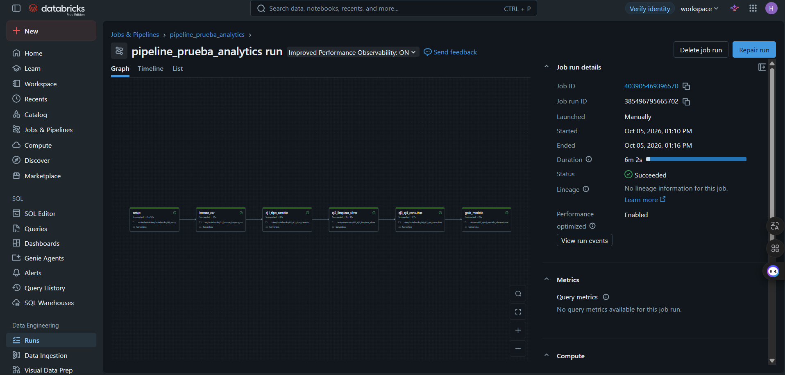

# Prueba técnica – Analytics Engineer Junior

Pipeline en Databricks Free Edition (serverless, Unity Catalog, Delta) con arquitectura medallion: bronze guarda
los datos tal como llegan, silver los datos limpios y validados, y gold el modelo dimensional.

Las respuestas de cada ejercicio, las decisiones y el modelo dimensional están en
[docs/Informe.pdf](docs/Informe.pdf).

## Estructura

```
notebooks/                     notebooks en formato fuente de Databricks
salida_databricks/             los mismos notebooks ejecutados, con resultados (.ipynb)
sql/ejercicio3_ejercicio4.sql  consultas del ejercicio 3 y corrección del ejercicio 4
src/banguat.py                 cliente SOAP del Banguat
data/raw/                      CSV originales
data/out/                      tipo_cambio_raw.xml, tipo_cambio.csv, transacciones_gtq.csv, dq_reporte.csv
docs/                          informe y captura de la ejecución del Job
```

| Notebook | Contenido |
|---|---|
| `_config` | Catálogo, esquemas y rutas compartidas |
| `00_setup` | Esquemas, volúmenes, carga de CSV y prueba de conectividad con el Banguat |
| `01_bronze_ingesta_csv` | CSV a bronze, todas las columnas como texto |
| `02_ej1_tipo_cambio` | Ejercicio 1 |
| `03_ej2_limpieza_silver` | Ejercicio 2 |
| `04_ej3_ej4_consultas` | Ejercicios 3 y 4 |
| `05_gold_modelo_dimensional` | Modelo estrella |

## Ejecución

El repositorio se clona en Databricks como Git folder y los notebooks se ejecutan con el Job
`pipeline_prueba_analytics`: seis tareas encadenadas de `00` a `05`, con compute serverless.



## Supuestos

- Las referencias al "ejercicio 5" corresponden al ejercicio 4 (depuración). `tipo_cambio` alimenta los ejercicios
  2 y 3.
- "El modelo del ejercicio 4" se refiere a un ejercicio de modelado que no aparece en el enunciado; se entrega un
  modelo estrella como capa gold.
- La pregunta "Responde brevemente: en producción" está incompleta; se responde cómo se operaría el proceso en
  producción.
- `fecha_alta` con barras está en formato día/mes/año y `fecha_hora` en hora de Guatemala.
- Un monto negativo en un débito es una convención de signo: la dirección la indica `tipo`.
- En el ejercicio 3 solo cuentan las transacciones `COMPLETADA`, y "monto transaccionado" es créditos más débitos.

